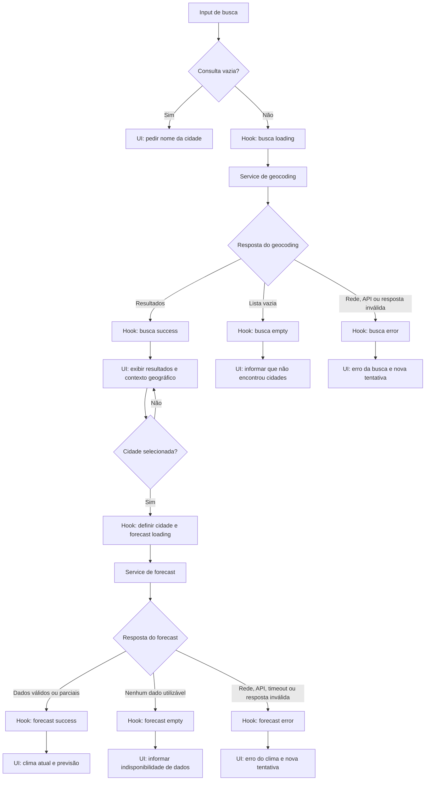

# Plano Técnico — Weather App

Este plano deriva da [especificação do produto](../specs/weather-app-spec.md).
Ele define arquitetura, contratos e decisões para orientar a implementação; não
substitui a spec nem contém o código final.

> **Gate de escopo:** a baseline funcional do MVP foi aprovada em 27/10/2026.
> A produção continua bloqueada pelos gates remanescentes da spec.
> O contrato aprovado abaixo substitui propostas funcionais anteriores; isso
> não comprova aderência integral do código nem aprovação operacional.

## Baseline funcional aprovada

- Busca explícita por nome com `trim`, sem normalização, ordenação ou limite
  adicionais aos do provedor; sem sugestões enquanto digita.
- Previsão diária de hoje e quatro dias seguintes com `timezone=auto`.
  `current`, `daily` e `daily.time` são obrigatórios; métricas são opcionais.
- Celsius na origem; Fahrenheit derivado na apresentação, sem persistência
  entre visitas. Números usam `Intl.NumberFormat('pt-BR')` com até uma casa
  decimal. Datas usam dia/mês e rótulos pt-BR, preservando a data civil.
- Timeout de 10 segundos cobre `fetch` e leitura do JSON, com `AbortController`
  e limpeza do timer. Falha permite retry manual; não há atualização periódica.
- A política específica de limite de uso, matriz de suporte, metas/medições
  não funcionais e condições do provedor permanecem gates de produção.

### Evidências e limites da preparação para produção

Em 27/10/2026, após as correções desta preparação, `pnpm lint`, `pnpm build`,
`pnpm test` (112 testes) e `pnpm test:e2e` (18 testes) passaram localmente.
Isso não comprova WCAG AA, disponibilidade ou desempenho p95.
Os scripts dos validadores SDD também passaram localmente, sem confirmação
da execução completa no GitHub Actions.

A preparação corrige seleção explícita entre múltiplas cidades, preserva
precipitação nula como indisponível e anuncia cobertura parcial de datas.
O hook usa `selecting` quando há múltiplos resultados, sem consultar previsão
até a seleção; um resultado único mantém a consulta automática. Testes do hook,
componentes e E2E cobrem esses comportamentos. Isso não substitui os gates
operacionais nem uma avaliação de conformidade completa.

## Architecture

Aplicação client-side em React com fluxo de dependências unidirecional. Cada
camada tem uma responsabilidade e depende apenas das camadas abaixo:

```text
Pessoa
  ↓ ações / eventos
components/  apresentação e interação acessível
  ↓ callbacks
hooks/       estado e orquestração de busca/seleção/clima
  ├── services/  I/O, Open-Meteo e normalização de respostas
  └── lib/       funções puras de conversão, rótulos e formatação
  ↓
components/  renderiza dados normalizados e estados
```

- **Apresentação (`components/`)**: componentes pequenos, um por arquivo,
  recebem dados/estados por props e comunicam intenções por callbacks. Renderizam
  busca, seleção, clima atual, previsão, unidade e estados de carregamento,
  erro e vazio. Não fazem requisições nem interpretam respostas HTTP.
- **Orquestração e estado (`hooks/`)**: `useWeather` coordena consulta,
  resultados, seleção atual, carregamento, erro, retry e unidade. Evita que
  respostas atrasadas substituam a cidade atual; mantém a busca e consulta do
  clima como estados distintos.
- **Acesso a dados (`services/`)**: encapsula URLs, parâmetros, transporte HTTP,
  validação de payload e mapeamento do formato Open-Meteo para os tipos
  normalizados da aplicação. Não contém decisões de apresentação.
- **Funções puras (`lib/`)**: agrupa conversão de temperatura, formatação e
  tradução de códigos WMO. Recebe valores e devolve resultados sem rede, estado
  React ou efeitos colaterais.
- **Composição (`App.tsx`)**: conecta o hook aos componentes e define a
  composição da tela; `main.tsx` apenas inicializa a aplicação.

Não há backend, autenticação, banco de dados ou cache na baseline. A rede é
acessada somente por `services/`; isso permite trocar ou simular a fonte sem
alterar componentes. Não introduzir camada de repositório, cliente de estado
global ou abstrações adicionais enquanto o escopo continuar restrito a uma tela
e uma fonte de dados.

## Tech Stack

- **TypeScript strict, React e Vite**: stack do repositório para uma SPA sem
  servidor próprio.
- **Tailwind CSS**: estilos responsivos e tema dark glassmorphism conforme a
  convenção do projeto.
- **Open-Meteo Geocoding e Forecast**: busca de localidades e dados
  meteorológicos, sem API key na configuração prevista pela spec.
- **Vitest e Testing Library**: testes unitários/de componentes e estados
  acessíveis.
- **Playwright**: validação E2E dos fluxos principais.
- **Biome e pnpm**: lint/formatação e gerenciamento de dependências já
  configurados no repositório.

## Project Structure

Estrutura proposta, compatível com a arquitetura documentada no repositório:

```text
src/
├── components/
│   ├── states/
│   │   ├── LoadingState.tsx    # carregamento acessível
│   │   ├── EmptyState.tsx      # busca sem resultados
│   │   └── ErrorState.tsx      # erro e ação de nova tentativa
│   ├── SearchForm.tsx          # entrada e envio explícito da consulta
│   ├── SearchResults.tsx       # resultados e seleção explícita
│   ├── WeatherPanel.tsx        # composição do conteúdo meteorológico
│   ├── CurrentWeather.tsx      # clima atual
│   ├── ForecastList.tsx        # lista de períodos/datas
│   └── TemperatureUnitToggle.tsx # controle Celsius/Fahrenheit
├── hooks/
│   └── useWeather.ts           # estado e coordenação dos fluxos
├── services/
│   └── openMeteo.ts            # HTTP, validação e normalização
├── lib/
│   ├── temperature.ts          # conversões e formatação de temperaturas
│   ├── weatherCode.ts          # códigos WMO para rótulos pt-BR
│   └── date.ts                 # formatação de datas, após decisão de fuso
├── types/
│   └── weather.ts              # contratos compartilhados
├── styles/
│   └── index.css               # estilos globais/Tailwind
├── App.tsx
└── main.tsx
```

Manter um componente React por arquivo e evitar arquivos de função ou
componentes genéricos sem necessidade concreta. Testes acompanham as áreas sob
`tests/`: unitários para `lib/` e `services/`, testes de componentes com
Testing Library e E2E para os fluxos completos com Playwright.

### Responsabilidades e testabilidade

- **`lib/`**: testar com entradas e saídas diretas, sem DOM, rede ou mocks.
  Casos como campo ausente, conversão e códigos WMO ficam rápidos e
  determinísticos.
- **`services/`**: simular `fetch` para validar URLs/parâmetros, mapeamento,
  respostas parciais e erros sem depender da disponibilidade da API externa.
- **`hooks/`**: testar loading, seleção, retry e respostas fora de ordem usando
  serviços simulados; isso verifica as regras de coordenação sem acoplar o teste
  à implementação HTTP.
- **`components/`**: Testing Library verifica conteúdo, ações, teclado e estados
  acessíveis através do comportamento visível, sem conhecer detalhes internos
  do hook ou serviço.
- **Fluxo integrado**: Playwright valida busca → seleção → clima e alternância
  de unidade com respostas controladas; um teste isolado com API real pode ser
  usado manualmente, mas não deve tornar a suíte dependente de rede externa.

A separação dá falhas de teste mais localizadas: transformações são cobertas
como funções puras, o contrato com a API é exercitado isoladamente e a UI é
validada sem exigir chamadas reais. O fluxo E2E permanece para confirmar a
integração entre as camadas.

## Data Model

Os contratos abaixo representam dados normalizados da aplicação, não os tipos
brutos da resposta HTTP. A ausência permanece explícita: nunca converter campo
ausente em `0` nem inferir condição ou data.

```ts
type Unit = 'celsius' | 'fahrenheit';

interface City {
  id?: number;
  name: string;
  admin1?: string;
  country?: string;
  latitude: number;
  longitude: number;
  timezone?: string;
}

interface CurrentWeather {
  temperatureC?: number;
  weatherCode?: number;
  humidityPercent?: number;
  windSpeedKmh?: number;
  precipitationMm?: number;
  pressureHpa?: number;
}

interface ForecastDay {
  date: string; // data ISO recebida da fonte
  temperatureMaxC?: number;
  temperatureMinC?: number;
  weatherCode?: number;
  precipitationProbabilityPercent?: number;
}

interface WeatherData {
  city: City;
  current: CurrentWeather;
  forecast: ForecastDay[];
}
```

`admin1`, `country` e `id` são opcionais porque podem não estar presentes no
resultado de geocodificação. Campos meteorológicos opcionais representam
indisponibilidade, não um valor calculado. Os campos diário `temperatureMaxC`,
`temperatureMinC` e `weatherCode` são uma proposta de contrato para previsão
diária, agora aprovada na baseline funcional; as métricas permanecem opcionais.

A fonte é solicitada em Celsius e a aplicação mantém temperaturas normalizadas
em Celsius. A unidade escolhida afeta somente a apresentação; valores ausentes
continuam ausentes. A apresentação usa `pt-BR` com até uma casa decimal, conforme
a baseline funcional aprovada.

## Data Flow

1. A pessoa envia a busca por ação explícita. A interface remove espaços
   externos; se o valor ficar vazio, mostra a validação local e não chama a API.
2. O serviço de geocodificação consulta a Open-Meteo. Resultados vazios geram
   estado vazio; falha de rede, HTTP ou resposta inválida gera estado de erro,
   distinto de ausência de resultados.
3. A interface apresenta nome e contexto geográfico disponível e exige seleção
   explícita, inclusive quando houver homônimos.
4. Ao selecionar uma cidade, a aplicação encerra ou invalida a solicitação
   meteorológica anterior, limpa os dados meteorológicos anteriores e inicia a
   consulta para latitude/longitude selecionadas.
5. O serviço valida e normaliza a resposta. Só a solicitação ainda associada à
   seleção atual pode publicar o resultado; uma resposta atrasada de uma cidade
   anterior é ignorada.
6. A interface apresenta somente campos e datas recebidos. A preferência de
   unidade formata todas as temperaturas disponíveis sem alterar dados,
   condições ou datas.
7. Uma falha não reaproveita o último resultado. A pessoa pode tentar novamente
   para a consulta ou localidade atual.



O hook mantém estados separados para busca e forecast. Respostas atrasadas de
uma seleção anterior são descartadas; uma falha não reapresenta dados antigos.

## External APIs

Todas as chamadas ficam no serviço `openMeteo`; não há chave secreta ou
credencial no cliente. As consultas enviam o texto de busca ou as coordenadas ao
provedor, conforme informado na spec. Os exemplos abaixo resumem campos úteis
para os contratos da aplicação; a normalização deve tolerar campos opcionais e
validar a resposta antes do mapeamento.

**Geocoding**

- **URL:** `https://geocoding-api.open-meteo.com/v1/search`
- **Parâmetros:** `name` (obrigatório; consulta aparada), `count` (opcional;
  padrão documentado 10, máximo 100), `language=pt` (respostas localizadas
  quando disponíveis), `format=json` (formato de resposta padrão). Exemplo:
  `https://geocoding-api.open-meteo.com/v1/search?name=Lisbon&count=10&language=pt&format=json`.
  A baseline usa os padrões do provedor, sem limite ou ordenação próprios.
- **Resposta resumida:**

  ```json
  {
    "results": [
      {
        "id": 2267057,
        "name": "Lisbon",
        "latitude": 38.71667,
        "longitude": -9.13333,
        "timezone": "Europe/Lisbon",
        "country_code": "PT",
        "country": "Portugal",
        "admin1": "Lisbon"
      }
    ]
  }
  ```

- **Mapeamento:** cada objeto de `results` vira um `City`: `id`,
  `name`, `latitude` e `longitude` são copiados; `admin1`, `country` e
  `timezone` são copiados quando presentes. Campos adicionais da API, como
  `country_code` e `elevation`, não fazem parte do contrato atual. `results`
  ausente ou vazio representa ausência de resultados; erro HTTP, de rede ou
  payload inválido representa falha, não lista vazia.

**Forecast**

Política de ausência nos campos consumidos: `results` nulo/omitido representa
lista vazia. `id`, `admin1`, `country` e `timezone` nulos são normalizados para
`undefined`; nome vazio e coordenadas ausentes/nulas invalidam a localidade,
sem inventar identidade ou posição. Campos numéricos de `current` e valores
dos arrays diários nulos/omitidos/não finitos ficam `undefined`, exceto
precipitação atual explicitamente nula (0 mm). Arrays diários opcionais nulos,
omitidos ou curtos não deslocam os índices. A UI mostra “Indisponível” para
valores ausentes/não finitos e “Data indisponível” para datas inválidas.
Blocos `current`/`daily` ou `daily.time` ausentes/nulos, assim como entradas de
data não textuais, geram erro explícito, não sucesso com dados inventados.

- **URL:** `https://api.open-meteo.com/v1/forecast`
- **Parâmetros do exemplo:** `latitude` e `longitude` da cidade selecionada;
  `current=temperature_2m,weather_code,relative_humidity_2m,wind_speed_10m,precipitation,surface_pressure`
  para temperatura, condição, umidade relativa, velocidade do vento,
  precipitação e pressão atuais;
  `daily=temperature_2m_max,temperature_2m_min,weather_code,precipitation_probability_max`
  para valores diários e probabilidade máxima diária de precipitação;
  `forecast_days=5` para hoje e os quatro dias seguintes;
  `timezone=auto` para datas no fuso local; `temperature_unit=celsius` para
  manter os dados internos em Celsius. Exemplo:
  `https://api.open-meteo.com/v1/forecast?latitude=38.71667&longitude=-9.13333&current=temperature_2m%2Cweather_code%2Crelative_humidity_2m%2Cwind_speed_10m%2Cprecipitation%2Csurface_pressure&daily=temperature_2m_max%2Ctemperature_2m_min%2Cweather_code&forecast_days=5&timezone=auto&temperature_unit=celsius`.
- **Resposta resumida:**

  ```json
  {
    "latitude": 38.75,
    "longitude": -9.125,
    "timezone": "Europe/Lisbon",
    "current_units": {
      "temperature_2m": "°C",
      "weather_code": "wmo code",
      "relative_humidity_2m": "%",
      "wind_speed_10m": "km/h",
      "precipitation": "mm",
      "surface_pressure": "hPa"
    },
    "current": {
      "time": "2026-10-27T16:00",
      "temperature_2m": 18.4,
      "weather_code": 3,
      "relative_humidity_2m": 64,
      "wind_speed_10m": 12.5,
      "precipitation": 0.1,
      "surface_pressure": 1013.2
    },
    "daily_units": {
      "time": "iso8601",
      "temperature_2m_max": "°C",
      "temperature_2m_min": "°C",
      "weather_code": "wmo code",
      "precipitation_probability_max": "%"
    },
    "daily": {
      "time": [
        "2026-10-27",
        "2026-10-28",
        "2026-10-29",
        "2026-10-30",
        "2026-10-31"
      ],
      "temperature_2m_max": [20.1, 19.8, 18.9, 20.4, 21.0],
      "temperature_2m_min": [14.2, 13.9, 13.1, 14.0, 14.7],
      "weather_code": [3, 2, 61, 3, 1],
      "precipitation_probability_max": [10, 20, 80, 15, 5]
    }
  }
  ```

- **Mapeamento:** `current.temperature_2m` vira
  `CurrentWeather.temperatureC`; `current.weather_code` vira
  `CurrentWeather.weatherCode`; `current.relative_humidity_2m`,
  `current.wind_speed_10m`, `current.precipitation` e
  `current.surface_pressure` viram, respectivamente,
  `humidityPercent`, `windSpeedKmh`, `precipitationMm` e `pressureHpa`. Os
  rótulos e ícones da condição devem ser derivados do código WMO localmente,
  sem tratar o código numérico como texto descritivo. Essas métricas permanecem
  opcionais quando ausentes na resposta.
  Exceção: `current.precipitation === null` é normalizado para
  `precipitationMm: 0`; campo omitido continua `undefined`, assim como
  probabilidade diária ausente ou nula.
  Para cada índice `i` de `daily.time`, criar um `ForecastDay` com
  `date=daily.time[i]`, `temperatureMaxC=daily.temperature_2m_max[i]`,
  `temperatureMinC=daily.temperature_2m_min[i]` e
  `weatherCode=daily.weather_code[i]` e
  `precipitationProbabilityPercent=daily.precipitation_probability_max[i]`.
  A probabilidade é percentual e opcional; se ausente, indicar indisponibilidade
  sem inferir. Vincular current e forecast à `City` selecionada para formar
  `WeatherData`.
- O contrato diário aprovado atende “hoje e os quatro dias seguintes” no fuso
  da cidade, com métricas opcionais. Não assumir cinco datas
  completas: mapear somente datas/valores recebidos, indicar ausências e não
  inferir dados ausentes. Se a solicitação falhar por completo, não manter o
  snapshot anterior.

O serviço deve validar a estrutura e os tipos das respostas antes de
normalizá-las. Uma resposta malformada é falha, não sucesso vazio. Validar
limites de uso, cobertura, licença, atribuição, disponibilidade e adequação ao
tráfego esperado da Open-Meteo antes do lançamento. Referências oficiais:
[Geocoding API](https://open-meteo.com/en/docs/geocoding-api) e
[Weather Forecast API](https://open-meteo.com/en/docs).

## State Management

Usar estado local React, centralizado no hook `useWeather` e passado à
apresentação por props. `App.tsx` compõe o hook e os componentes, sem duplicar
estado de domínio. Não introduzir biblioteca global nem persistência. Manter
busca e consulta meteorológica independentes para distinguir ausência de
resultados, carregamento e falha.

Contratos discriminados sugeridos:

```ts
type RequestErrorKind = 'network' | 'api' | 'timeout' | 'invalid-response';

interface RequestError {
  kind: RequestErrorKind;
  message: string;
}

type SearchState =
  | { status: 'idle' }
  | { status: 'loading'; query: string }
  | { status: 'success'; results: City[] }
  | { status: 'empty'; query: string }
  | { status: 'error'; error: RequestError };

type WeatherState =
  | { status: 'idle' }
  | { status: 'loading'; location: City }
  | { status: 'success'; data: WeatherData }
  | { status: 'empty'; location: City }
  | { status: 'error'; location: City; error: RequestError };
```

`idle` significa que ainda não há solicitação (ou cidade selecionada);
`loading` acompanha uma solicitação ativa; `success` contém resultados; `empty`
indica busca concluída sem localidades, ou resposta meteorológica válida sem
nenhum dado utilizável; `error` representa uma solicitação que falhou. Em
resposta meteorológica parcial com ao menos algum dado, manter `success` e
marcar os campos/períodos ausentes como indisponíveis. Não converter ausência em
zero nem confundir erro com estado vazio.

A unidade vive no estado local da sessão, com valor inicial `celsius`; a spec
não inclui persistência entre visitas. Dados recebidos ficam normalizados em
Celsius. Ao renderizar, derivar cada valor disponível conforme `Unit`:

```ts
fahrenheit = (celsius * 9) / 5 + 32;
celsius = ((fahrenheit - 32) * 5) / 9;
```

Uma função pura de `lib/temperature.ts` deve realizar a conversão/formatação
para os componentes. A alternância só muda `Unit` e re-renderiza valores atuais
e diários; não altera o `WeatherData` original nem inicia novo request. Valores
ausentes permanecem indisponíveis. A apresentação usa `pt-BR` com até uma casa
decimal, conforme a baseline funcional aprovada.

## Error Handling

- **Rede:** falhas de conexão, DNS ou `fetch` resultam em `error` com tipo
  `network`; encerrar loading, mostrar mensagem em pt-BR apropriada à ação que
  falhou e permitir nova tentativa.
- **API:** respostas HTTP não bem-sucedidas, incluindo limite de uso, resultam
  em `error` de tipo `api`, não em busca vazia. Preservar status/código para
  diagnóstico e apresentar mensagem de falha; não expor detalhes técnicos como
  substituto da mensagem ao usuário.
- **Timeout:** usar cancelamento via `AbortController` quando uma seleção nova
  substituir a solicitação anterior. Solicitações também devem ter limite de
  duração de 10 segundos, incluindo leitura do corpo. A mensagem aprovada é
  “A requisição demorou demais.”; o erro permite retry.
- **Resposta inválida:** payload malformado ou incompatível gera `error` de tipo
  `invalid-response`; nunca converter falha de parsing/validação em sucesso
  vazio ou dados padrão.
- **Resposta parcial:** validar os campos individualmente. Campos e datas
  ausentes ficam indisponíveis sem inferência; dados utilizáveis permanecem em
  `success` parcial, sem sugerir cobertura integral. Uma resposta válida sem
  nenhum dado utilizável usa `empty`. Resposta com falha completa usa `error`.
- **Concorrência e dados anteriores:** invalidar/cancelar operações antigas e
  aceitar somente a resposta associada à consulta/seleção atual. Ao selecionar
  outra cidade ou ocorrer erro, não exibir dados da seleção anterior, nem
  oferecer cache ou fallback.
- O serviço deve propagar um erro tipado/normalizado para o hook; evitar `catch`
  que esconda falhas. O hook encerra o estado de carregamento em todos os
  resultados e expõe retry para a busca ou cidade atual.
- Estados de carregamento, erro e vazio devem ser identificáveis por tecnologia
  assistiva; controles e nova tentativa devem ser operáveis por teclado.
- Mensagens e tratamento específicos para limite de uso dependem de decisão
  operacional; não assumir retry automático ou prazos específicos.

## Testing Strategy

- **Funções puras (Vitest):** testar conversão Celsius ↔ Fahrenheit, preservação
  de valores ausentes, formatação de temperatura e mapeamento de códigos WMO.
  Testar também aparo/validação da consulta e, após definição de formato e fuso,
  formatação de datas. Não precisam de DOM nem mocks; casos-limite e resultados
  determinísticos ficam rápidos de diagnosticar.
- **Services (Vitest com `fetch` mockado):** verificar URL e parâmetros de
  geocoding/forecast; mapear exemplos válidos para os contratos; aceitar
  respostas parciais sem inventar valores; distinguir resultado vazio, erro
  HTTP/limite de uso, falha de rede, timeout e JSON/payload inválido. Os mocks
  evitam depender da internet, da cota ou de mudanças momentâneas no provedor.
- **Componentes (Vitest + Testing Library):** verificar comportamento observável
  dos estados `idle`, `loading`, `success`, `empty` e `error`; busca explícita,
  validação de entrada vazia, resultados/contexto geográfico, seleção e retry;
  exibição de indisponibilidade para campos ausentes; unidade inicial Celsius e
  alternância que atualiza todas as temperaturas sem nova chamada ao serviço.
  Incluir nomes acessíveis e operação por teclado nos controles e estados
  relevantes.
- **Hook/orquestração (Vitest):** usar services simulados para validar
  transições de estado, seleção da localidade, limpeza de dados anteriores,
  retry, cancelamento e respostas fora de ordem. Uma resposta antiga não pode
  substituir a seleção mais recente.
- **E2E (Playwright):** cobrir o fluxo principal busca → resultados → seleção →
  clima atual/previsão → alternância de unidade; e fluxos de busca sem
  resultados, falha/retry e feedback de loading. Interceptar a API com respostas
  controladas para manter os testes determinísticos; a suíte não depende de
  Open-Meteo ao vivo.
- **Viewport mobile (Playwright):** executar os fluxos essenciais em pelo menos
  um viewport mobile de retrato e verificar que busca, seleção, conteúdo
  meteorológico e controle de unidade permanecem visíveis/usáveis, sem corte de
  conteúdo funcional ou rolagem horizontal. A matriz exata de viewports,
  dispositivos e orientações é um gate candidato de RNF-01 e deve ser aprovada
  antes de ser critério quantitativo de lançamento.
- Rastrear os testes aos critérios CA-01 a CA-07 da spec. Datas/fuso,
  arredondamento e timeout seguem a baseline aprovada; a validação de
  RNFs depende dos respectivos gates. Não tratar alvos candidatos
  de responsividade, acessibilidade, desempenho e disponibilidade como metas
  aceitas.

## Risks & Trade-offs

| Decisão / trade-off | Alternativa considerada | Justificativa e consequência |
| --- | --- | --- |
| Chamar Open-Meteo do cliente via `services/`, sem backend próprio. | Criar backend/proxy para intermediar as chamadas. | A SPA não precisa de segredo e a spec exclui persistência no servidor; chamada direta reduz infraestrutura. Mantém, porém, dependência de rede/provedor no cliente e exige validar condições de uso, CORS, cota, privacidade e atribuição antes do lançamento. |
| Estado React local em `useWeather`. | Biblioteca global de estado ou cache de servidor. | Uma tela e poucos fluxos não justificam dependência/abstração adicional. Se o app crescer para múltiplas telas ou cache compartilhado, reavaliar. |
| Normalizar temperaturas para Celsius e derivar Fahrenheit na apresentação. | Solicitar novamente à API ao trocar unidade ou manter os dados na unidade selecionada. | Evita round-trip e mantém uma fonte única; conversão centralizada, com apresentação pt-BR de até uma casa decimal aprovada. |
| Sem cache e sem exibir consulta anterior após falha. | Manter último resultado enquanto atualiza ou oferecer modo offline. | Segue RF-06 e evita apresentar dados obsoletos como atuais; reduz resiliência percebida quando a conexão falha. Cache/offline permanece fora do escopo confirmado. |
| Previsão diária por cinco datas aprovada na baseline. | Previsão horária, ou diária e horária combinadas. | Cobre o objetivo de cinco dias sem aumentar a complexidade; métricas opcionais não são sintetizadas. |
| Datas no fuso local da cidade (`timezone=auto`), aprovadas na baseline. | Usar UTC ou fuso do dispositivo. | Associa “hoje” à cidade consultada; preservar as datas civis recebidas na apresentação. |
| Testes de integração com API interceptada/mockada. | Fazer a suíte automatizada depender da Open-Meteo real. | Interceptação dá execução repetível e não consome cota nem falha por indisponibilidade externa; não substitui uma verificação operacional/manual do provedor. |
| Camadas leves `components` / `hooks` / `services` / `lib`. | Arquitetura mais estratificada (repositórios, adaptadores e estado global). | As quatro responsabilidades isolam UI, coordenação, I/O e funções puras com baixo custo. Camadas extras seriam prematuras para o escopo atual e podem ser adicionadas se surgirem múltiplas fontes ou regras de domínio mais complexas. |
| Dependência direta da cobertura, disponibilidade, cota e condições de uso da Open-Meteo. | Provedor alternativo ou camada multi-provedor desde o início. | A fonte única simplifica o primeiro release, mas cria dependência operacional. Confirmar limites, licença, atribuição, privacidade e adequação ao tráfego; não adicionar abstração multi-provedor sem necessidade confirmada. |
| Estados parciais explícitos e sem valores inferidos. | Completar lacunas com defaults, interpolação ou último valor conhecido. | Evita dados meteorológicos enganadores e atende à spec; a interface deve comunicar campos/datas indisponíveis e não sugerir cobertura integral. |
| Validar usabilidade mobile e acessibilidade em testes focados. | Declarar conformidade com matriz ampla de dispositivos/tecnologias sem validação. | Evita compromisso além dos gates ainda abertos da spec; os alvos e matriz finais de RNF-01/RNF-02 precisam de aprovação antes do aceite de produção. |
